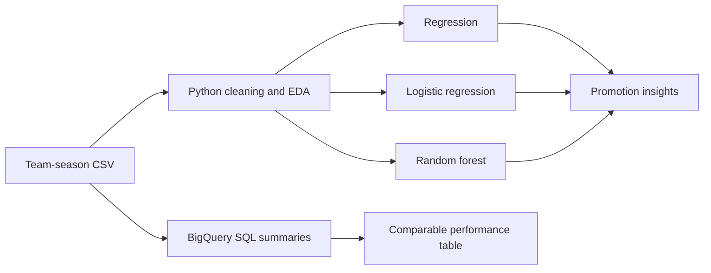

# EFL Championship Promotion Analysis

### Find the performance signals associated with promotion using SQL, Python, and BigQuery

[](https://www.python.org/)
[](https://cloud.google.com/bigquery)
[](https://scikit-learn.org/)

This project analyzes 480 team-season observations across 20 English Football League Championship seasons to understand which performance measures are associated with promotion. It combines BigQuery-ready SQL for repeatable summaries with Python for exploratory analysis, regression, logistic regression, and random-forest modeling.

## Contents

- [Why this project is useful](#why-this-project-is-useful)
- [Key findings](#key-findings)
- [Quick start](#quick-start)
- [Run the SQL workflow](#run-the-sql-workflow)
- [Technical workflow](#technical-workflow)
- [Project structure](#project-structure)
- [Limitations and known issues](#limitations-and-known-issues)
- [Contribution](#contribution)
- [Support](#support)
- [License](#license)

## Why this project is useful

A club analyst or sporting director could use this workflow to ask:

- Which team metrics move most closely with points and promotion?
- Can promotion status be modeled from season-level performance?
- Which variables matter most in a random-forest model?
- Are historical measurement changes affecting the conclusions?

The goal is not to claim that a model guarantees promotion. The goal is to make the evidence and assumptions easy to inspect.

## Key findings

- Points, goal difference, and attacking performance are central signals in the team-season data.
- Logistic regression and random forest provide complementary views of promotion status.
- Shot-accuracy distributions show a historical break caused by changes in data-collection criteria.
- The dataset excludes the incomplete 2024/25 season for a cleaner comparison across 20 seasons.

## Quick start

### Prerequisites

- Python 3.10 or newer
- Git
- Optional: a Google Cloud project with BigQuery access for the SQL workflow

```powershell
git clone https://github.com/rlaaudwp96/EFL-Promotion-Analysis.git
cd EFL-Promotion-Analysis
python -m venv .venv
.\.venv\Scripts\Activate.ps1
pip install -r requirements.txt
python efl_analysis.py
```

The script uses the included cleaned table and prints the main summaries and model results.

## Run the SQL workflow

The query in `sql/promotion_analysis.sql` is ready to adapt to a BigQuery table. Replace the project and dataset identifiers, then run it in the BigQuery console or through the BigQuery client.

```sql
-- Example BigQuery workflow
SELECT season, COUNT(*) AS team_seasons
FROM `your-project.your_dataset.efl_team_seasons`
GROUP BY season
ORDER BY season;
```

## Technical workflow



## Project structure

```text
EFL-Promotion-Analysis/
├── efl_analysis.py            # Reproducible Python analysis
├── sql/promotion_analysis.sql # BigQuery-ready summaries
├── efl_table_final_clean.csv  # Cleaned team-season table
├── EFL.ipynb                  # Exploratory notebook
├── requirements.txt
└── README.md
```

## Limitations and known issues

- This is observational data; the models identify association, not causation.
- Promotion formats and data definitions can change across seasons.
- BigQuery execution requires replacing the example table identifier and configuring cloud access.
- The included results should not be treated as a betting recommendation.

## Contribution

Open an issue with a reproducible example, keep SQL changes in `sql/`, keep Python analysis changes in `efl_analysis.py`, and include the expected output when opening a pull request.

## Support

Use GitHub Issues or connect with [Myungje Kim on LinkedIn](https://www.linkedin.com/in/evan-kim-257857249/).

## License

No open-source license has been specified yet. Contact the repository owner before redistributing or adapting the code.
